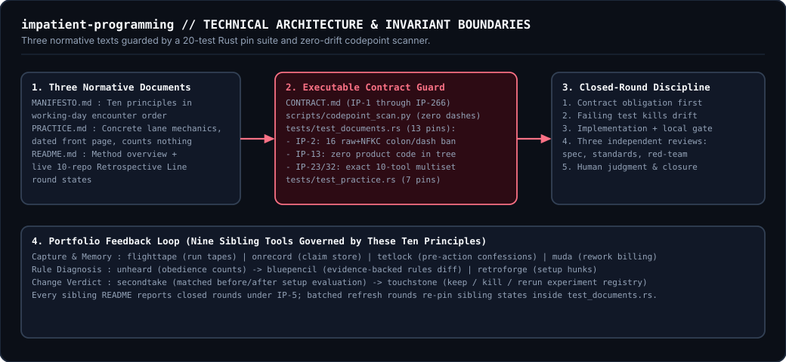

# Guard Architecture & Contract Boundaries

  

Manifestos usually rot the week after they are written: links break, sibling project statuses fall months behind, style rules are violated in edits, and stray scripts accumulate. `impatient-programming` treats prose claims as testable invariants governed by [`CONTRACT.md`](../CONTRACT.md) (`IP-1` through `IP-266`).

## 1. The Four Enforcement Layers

1. **The 16-Codepoint Prose Copy Bar (`IP-2`, `tests/test_documents.rs`)**:
   - Across `README.md`, `MANIFESTO.md`, and `PRACTICE.md`, all 16 raw and NFKC-normalized forms of colons (`:`), semicolons (`;`), em dashes (`U+2014`), en dashes (`U+2013`), and horizontal bars (`U+2015`) are forbidden. Every sentence must earn its structure through plain clauses rather than punctuation crutches or LLM dash tics.
2. **Repo-Wide Dash Scanner (`scripts/codepoint_scan.py`)**:
   - Walks `.md`, `.txt`, `.rs`, `.toml`, `.yml`, `.py`, and `.lock` files across the repository (skipping `.git` and top-level build/virtualenv directories `target`, `.cargo-home`, `.venv`, `venv`, `env`, `node_modules`, `__pycache__`, `_site`) and exits `1` if `U+2014` or `U+2013` appears.
3. **Zero Product Code Boundary (`IP-13`, `test_no_product_code_lives_in_the_repo`)**:
   - Walks the entire repository tree outside `scripts/`, `tests/`, `src/`, and `target/` and fails `cargo test` if any file carries one of 16 programming-language extensions (`.py`, `.js`, `.mjs`, `.jsx`, `.ts`, `.tsx`, `.go`, `.rs`, `.rb`, `.sh`, `.java`, `.c`, `.cc`, `.cpp`, `.swift`, `.php`). Even the GitHub Pages edition (`.github/workflows/pages.yml`) renders pure static HTML + CSS with **zero JavaScript**.
4. **Exact Multiset & State Pins (`IP-23`, `IP-32`)**:
   - `tests/test_documents.rs` pins the exact ordered list of ten principles, the exact ten-tool multiset under `## The tools`, and the exact closed-round phrase carried by each sibling bullet.
