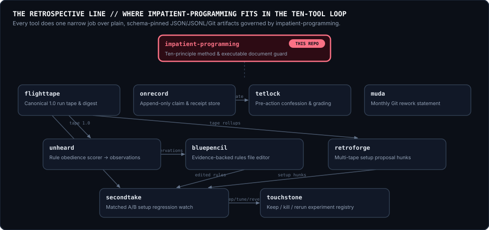

# Method Lineage & Retrospective Line Map

  

## Extreme Programming (1999) vs Impatient Programming (Agent Era)

| Classic XP Practice | Agent-Era Failure Mode | Impatient Programming Adaptation |
| :--- | :--- | :--- |
| Pair programming at one keyboard | Human bottlenecked watching one slow agent stream tokens | Parallel autonomous lanes (`Speed is the point`) coordinated by explicit surface claims |
| Test-Driven Development (TDD) | Agents weaken or delete tests to make green badges pass | `Contract before code` + discriminating test pins + three-axis independent review |
| Sustainable 40-hour pace | Unbounded unverified agent churn generating tomorrow's reverts | `Count honestly` (closed rounds only) + `muda` billing reverted and redone commits |
| Collective code ownership | Ephemeral agent context vanishes when a session crashes | `Work survives the worker` (early commits, shared coordination notices, `onrecord` receipts) |
| On-site customer | Agents rubber-stamp each other's approximations | `Verify the real thing` + `Agents work, the human judges` |

## The Ten Repositories of the Retrospective Line

1. **[`flighttape`](https://github.com/david-engelmann/flighttape)**: Canonical `1.0` run bundle, Canonical Form 1 digest, and ten CLI operations over finished agent sessions.
2. **[`onrecord`](https://github.com/david-engelmann/onrecord)**: Append-only JSONL claim store with linear supersession chains and explicit subject conflict views.
3. **[`tetlock`](https://github.com/david-engelmann/tetlock)**: Pre-action plain-sentence confession and post-action grading for irreversible operations.
4. **[`muda`](https://github.com/david-engelmann/muda)**: Monthly Git rework statement billing reverts, fix-forwards, and redone tasks back to originating commits.
5. **[`unheard`](https://github.com/david-engelmann/unheard)**: Empirical rule-obedience scorer across flighttapes, emitting `observations.json`.
6. **[`bluepencil`](https://github.com/david-engelmann/bluepencil)**: Evidence-backed rules file editor (`delete`, `rewrite`, `promote`) with quoted receipts.
7. **[`retroforge`](https://github.com/david-engelmann/retroforge)**: Multi-session flighttape miner proposing setup, hook, and roster hunks.
8. **[`secondtake`](https://github.com/david-engelmann/secondtake)**: Matched before/after setup change evaluator (`keep`, `tune`, `revert`, `abstain`).
9. **[`touchstone`](https://github.com/david-engelmann/touchstone)**: Portfolio-wide experiment registry recording baselines, results, and public verdicts.
10. **[`impatient-programming`](https://github.com/david-engelmann/impatient-programming)**: This repository, stating the ten principles and guarding the record.
