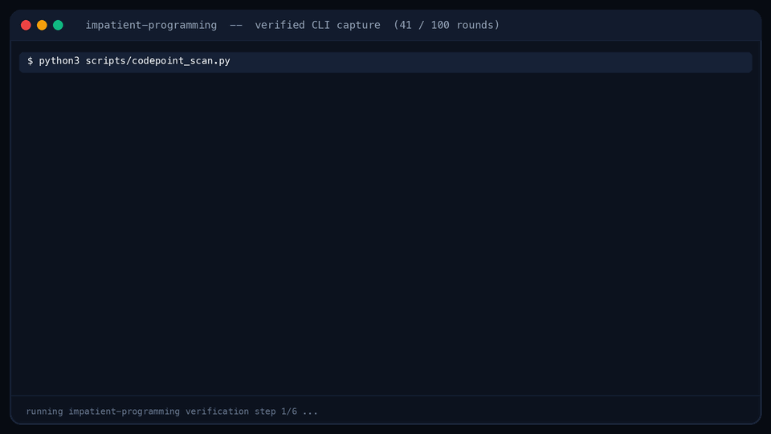

# Impatient Programming Reader & Verification Guide

<p align="center">
  
</p>

## 1. What Lives in This Repository

Unlike its nine sibling repositories in the Retrospective Line, `impatient-programming` ships **no product binary**. It holds three normative Markdown documents and the executable test harness that keeps their claims honest:

1. [`MANIFESTO.md`](../MANIFESTO.md) states the ten principles in the order an operator encounters them during a working day, from parallel lane speed through final human judgment.
2. [`PRACTICE.md`](../PRACTICE.md) translates those ten principles into concrete day-to-day lane mechanics as of the date on its opening page, deliberately carrying zero round counts of its own so it cannot drift against `README.md`.
3. [`README.md`](../README.md) summarizes the ten principles and records the closed-round state of all ten repositories in the Retrospective Line.

## 2. Running the Full Local Gate

Every local check matches CI command-for-command:

```sh
python3 scripts/codepoint_scan.py
cargo fmt --check
cargo clippy --all-targets -- -D warnings
cargo test
```

## 3. Adopting the Pattern in Your Own Fleet

Teams adopting Impatient Programming typically apply four mechanisms immediately:

- **Contract before code (`CONTRACT.md`)**: Write every behavioral obligation in a form a deterministic test can kill before changing implementation files.
- **Local gates identical to CI**: Never treat hosted CI as a scratchpad; run formatting, lints, codepoint/style scans, and tests locally before every push.
- **Three independent reviews per round**: Pair a fresh-eyes red-team audit with two orthogonal line-by-line reviews (specification fidelity and engineering standards) plus human verification on real artifacts.
- **Closed-round accounting**: Count progress only in completed, reviewed, merged rounds rather than partial passes or unverified commits.
