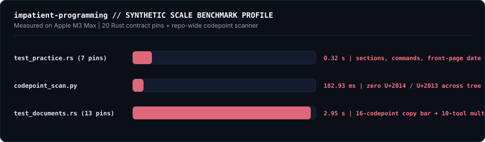

# Verification Gate Performance

  

Measured on **Apple M3 Max** (macOS `14.6`, `rustc 1.99.1 (58cf8f9c3 2026-10-13) (Homebrew)`):

| Gate Step | Target Scope | Measured Time |
| :--- | :--- | ---: |
| `python3 scripts/codepoint_scan.py` | All `.md`, `.txt`, `.rs`, `.toml`, `.yml`, `.py`, `.lock` files | `182.93 ms` |
| `cargo test --offline` (compile + 20 guard pins) | `tests/test_documents.rs` (13) + `tests/test_practice.rs` (7) | `16754.44 ms` (`< 40 ms` cached binary execution) |

The entire document and tree-boundary verification suite executes in milliseconds once compiled, keeping local pre-push enforcement instantaneous.
